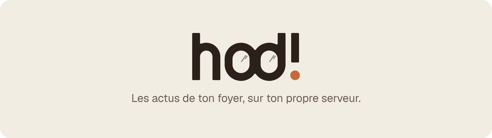
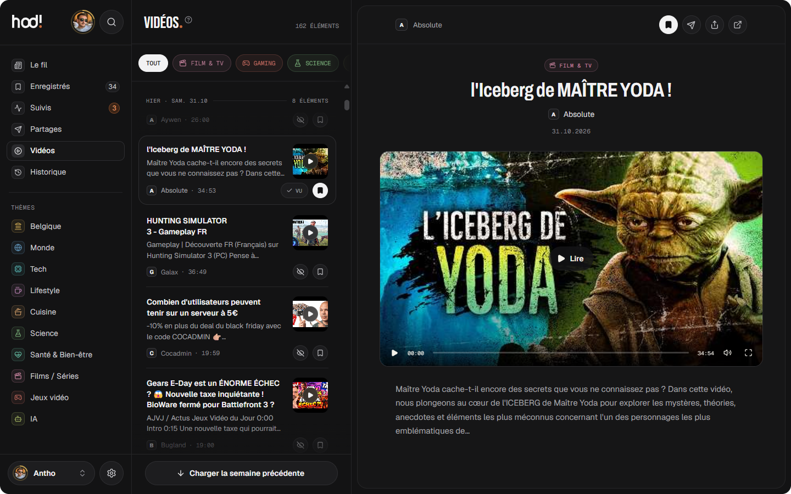

<p align="center">
  <picture>
    <source media="(prefers-color-scheme: dark)" srcset="docs/assets/banner-fr-dark.png">
    
  </picture>
</p>

<p align="center">
  Un lecteur d’actus auto-hébergé pour tout le foyer : les actus par thème, un mode lecture épuré, des vidéos,<br>
  jusqu’à cinq profils, et une IA optionnelle qui ne se lance que sur un clic.<br>
  <i>Hodi</i> vient du latin <i>hodie</i>, « aujourd’hui », et sonne comme le swahili <i>« Hodi ! »</i>,<br>
  ce qu’on lance en frappant à la porte d’une maison : les actus du jour, pour tous ceux qui vivent sous ce toit.
</p>

<p align="center">
  <a href="https://github.com/leclaudeur/hodi/actions/workflows/ci.yml"></a>
  <a href="https://github.com/leclaudeur/hodi/releases"></a>
  <a href="https://codecov.io/gh/leclaudeur/hodi"></a>
  <a href="LICENSE"></a>
  
  
</p>

<p align="center">
  <a href="#installation"><b>Installation</b></a> ·
  <a href="#fonctionnalités"><b>Fonctionnalités</b></a> ·
  <a href="#captures-décran"><b>Captures d’écran</b></a> ·
  <a href="#documentation"><b>Documentation</b></a> ·
  <a href="#contribuer"><b>Contribuer</b></a>
</p>

<p align="center"><a href="README.md">English</a> · <b>Français</b></p>

<p align="center">
  
</p>

<br>

## Intro

**Hodi** est un lecteur d’actus que tu héberges toi-même, pensé pour **tout un foyer**. Il rassemble les actus en
français et en anglais depuis des flux RSS publics, les range par thème et ouvre chaque article dans un _lecteur épuré,
sans pub_. Chaque personne de la maison a son propre profil, et tout reste sur **ta propre machine**, dans un seul
conteneur Docker et une petite base SQLite.

## Fonctionnalités

Hodi est calme, privé et fait pour être partagé.\
Il t’apporte **tout ce qu’il faut pour suivre l’actu**, et rien qui te fasse revenir sans raison.

- Le fil - _les articles de tous les thèmes, **un jour à la fois**, avec les sujets principaux du jour en haut_
- Mode lecture - _les articles s’ouvrent dans Hodi, sans pub ; ceux réservés aux abonnés sont masqués, **jamais
  contournés**_
- Thèmes et sources - _une vingtaine de thèmes avec des sources proposées, et chacun peut
  [ajouter les siennes](docs/sources.md) par un lien_
- Vidéos - _les dernières vidéos YouTube (**sans Shorts**) et les podcasts des chaînes que tu suis_
- Suivis - _suis un sujet (« Iran », « GTA 6 »…) et reçois une **notification** quand un nouvel article en parle_
- Profils - _jusqu’à **5 par foyer**, chacun avec ses réglages, son historique et ses stats ; un code en garde un privé_
- Partages - _envoie un article à quelqu’un de la maison avec un mot, et réagis à ce qu’on t’envoie_
- Le jeu - _des points, des niveaux et des badges pour la lecture, et un **défi de la semaine** pour tout le foyer_
- Hors ligne - _installe-le sur un téléphone ou un ordinateur, les derniers articles restent lisibles **sans
  connexion**_
- IA, en option - _résumés, questions et « Résumé du jour » avec ta propre clé (Claude pour l’instant), **seulement sur
  un clic**_

## Captures d’écran

<p align="center">
  
</p>

<p align="center">
  
</p>

## Installation

Il te faut juste [Docker](https://docs.docker.com/get-docker/) avec **Compose v2**, sur un ordinateur, un serveur à la
maison ou un petit VPS.

1. Récupère le code

   ```bash
   git clone https://github.com/leclaudeur/hodi.git hodi
   cd hodi
   ```

2. Lance Hodi

   ```bash
   docker compose up -d
   ```

3. Ouvre <http://localhost:3000> et suis l’installation dans ton navigateur

C’est tout : **aucun fichier de configuration, aucune variable d’environnement, aucune commande à retenir**. Tous les
réglages se font dans l’app.

> [!TIP]
> Pour lire depuis ton téléphone ou de n’importe où, mets Hodi derrière HTTPS. Le
> [guide de déploiement](docs/deployment.md) explique comment, ainsi que les mises à jour et les sauvegardes.

## Documentation

Tu trouveras ici **comment faire tourner Hodi** et **comment il fonctionne**. La documentation est en anglais.

1. [Déploiement](docs/deployment.md) - installation, premier lancement, HTTPS, mises à jour et sauvegardes
2. [Fonctionnalités](docs/features.md) - ce que fait chaque écran, et ce qui est stocké
3. [Sources](docs/sources.md) - les sources de départ, et comment en ajouter ou en vérifier une
4. [Sécurité](docs/security.md) - connexion, secrets, le conteneur et les requêtes sortantes
5. [Architecture](docs/architecture.md) - l’organisation du code, pour les contributeurs

## Contribuer

Les signalements de bugs, les idées et les pull requests sont **les bienvenus** !

Hodi a un seul mainteneur, qui relit et fusionne chaque pull request. Pour tout ce qui dépasse une petite correction,
**ouvre d’abord une issue** pour qu’on se mette d’accord sur l’approche avant que tu y passes du temps.

1. Lis le [guide de contribution](CONTRIBUTING.md) (en anglais) pour installer le projet et préparer une pull request
2. Fais ta modification sur une branche, avec des tests pour le côté serveur
3. Ouvre une pull request et remplis son modèle : ce qui change, comment tu l’as testé, des captures pour l’interface

> [!NOTE]
> Tu travailles avec un agent de code IA (Claude Code, Codex, Cursor…) ?
>
> - Indique-lui [AGENTS.md](AGENTS.md) : il contient les règles et les commandes du projet
> - Utilise les workflows prêts à l’emploi de [`.claude/skills/`](.claude/skills)

> [!IMPORTANT]
> Tu as trouvé un problème de sécurité ? **N’ouvre pas d’issue publique** : signale-le en privé, comme expliqué dans
> [SECURITY.md](SECURITY.md).

Merci de prendre le temps d’améliorer Hodi !

## Licence

Copyright © 2026 Le Claudeur et les contributeurs de Hodi.

Hodi est un logiciel libre sous licence [GNU AGPL-3.0](LICENSE) : tu peux l’**utiliser, le modifier et le partager**
librement, à condition de publier le code source d’une version modifiée que tu fais tourner pour d’autres personnes.

La licence couvre le code, pas le nom « Hodi » ni son logo : une version modifiée partagée avec d’autres prend son propre
nom. Voir [TRADEMARKS.md](TRADEMARKS.md) (en anglais).
