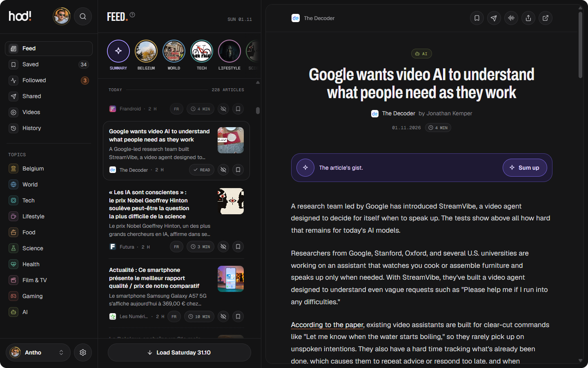

<p align="center">
  <picture>
    <source media="(prefers-color-scheme: dark)" srcset="docs/assets/banner-dark.png">
    
  </picture>
</p>

<p align="center">
  A self-hosted news reader for the whole household: news by theme, a clean reader view, videos,<br>
  up to five profiles, and optional AI that only ever runs when you click.<br>
  <i>Hodi</i> comes from the Latin <i>hodie</i>, “today”, and sounds like the Swahili <i>“Hodi!”</i>,<br>
  what you call out when you knock at a home’s door: today’s news, for everyone under one roof.
</p>

<p align="center">
  <a href="https://github.com/leclaudeur/hodi/actions/workflows/ci.yml"></a>
  <a href="https://github.com/leclaudeur/hodi/releases"></a>
  <a href="https://codecov.io/gh/leclaudeur/hodi"></a>
  <a href="LICENSE"></a>
  
  
</p>

<p align="center">
  <a href="#install"><b>Install</b></a> ·
  <a href="#features"><b>Features</b></a> ·
  <a href="#screenshots"><b>Screenshots</b></a> ·
  <a href="#documentation"><b>Documentation</b></a> ·
  <a href="#contributing"><b>Contributing</b></a>
</p>

<p align="center"><b>English</b> · <a href="README.fr.md">Français</a></p>

<p align="center">
  
</p>

<br>

## Intro

**Hodi** is a news reader you host yourself, made for a **whole household**. It gathers French and English news from
public RSS feeds, sorts it by theme and opens every article in a _clean, ad-free reader_. Everyone at home gets their own
profile, and everything stays on **your own machine**, in one Docker container and a small SQLite database.

## Features

Hodi is calm, private and made to be shared.\
It brings **everything you need to keep up with the news**, and nothing that pulls you back for no reason.

- Feed - _every theme’s articles, **one day at a time**, with the day’s main stories on top_
- Reader view - _articles open inside Hodi, without ads; subscriber-only ones are hidden, **never bypassed**_
- Themes and sources - _some twenty themes with suggested sources, and anyone can [add their own](docs/sources.md) by
  link_
- Videos - _the latest YouTube videos (**no Shorts**) and podcasts of the channels you follow_
- Followed - _follow a subject (“Iran”, “GTA 6”…) and get a **notification** when a new article mentions it_
- Profiles - _up to **5 per household**, each with its own settings, history and stats; a code keeps one private_
- Shared - _send an article to someone at home with a note, and react to what they send you_
- The game - _points, levels and badges for reading, and a **weekly challenge** for the whole household_
- Offline - _install it on a phone or a computer, the latest articles stay readable **without a connection**_
- AI, optional - _summaries, questions and the “Daily summary” with your own key (Claude today), **only on a click**_

## Screenshots

<p align="center">
  
</p>

<p align="center">
  
</p>

## Install

All you need is [Docker](https://docs.docker.com/get-docker/) with **Compose v2**, on a computer, a home server or a
small VPS.

1. Get the code

   ```bash
   git clone https://github.com/leclaudeur/hodi.git hodi
   cd hodi
   ```

2. Start Hodi

   ```bash
   docker compose up -d
   ```

3. Open <http://localhost:3000> and follow the setup in your browser

That’s it: **no configuration file, no environment variable, no command to remember**. Every setting lives in the app.

> [!TIP]
> To read from your phone or from anywhere, put Hodi behind HTTPS. The [deployment guide](docs/deployment.md) shows
> how, along with updates and backups.

## Documentation

Here you will find **how to run Hodi** and **how it works**.

1. [Deployment](docs/deployment.md) - install, first run, HTTPS, updates and backups
2. [Features](docs/features.md) - what each screen does, and what is stored
3. [Sources](docs/sources.md) - the starting sources, and how to add or check one
4. [Security](docs/security.md) - sign-in, secrets, the container and outgoing requests
5. [Architecture](docs/architecture.md) - how the code is organized, for contributors
6. [Performance](docs/performance.md) - Lighthouse scores, how they are measured, and what keeps Hodi fast

## Contributing

Bug reports, ideas and pull requests are **welcome**!

Hodi has a single maintainer, who reviews and merges every pull request. For anything bigger than a small fix, please
**open an issue first** so we can agree on the approach before you spend time on it.

1. Read the [contributing guide](CONTRIBUTING.md) to set up the project and prepare a pull request
2. Make your change on a branch, with tests for the server side
3. Open a pull request and fill in its template: what changes, how you tested it, screenshots for the UI

> [!NOTE]
> Working with an AI coding agent (Claude Code, Codex, Cursor…)?
>
> - Point it to [AGENTS.md](AGENTS.md): it holds the project’s rules and commands
> - Use the ready-made workflows in [`.claude/skills/`](.claude/skills)

> [!IMPORTANT]
> Found a security problem? Please **don’t open a public issue**: report it privately, as explained in
> [SECURITY.md](SECURITY.md).

Thanks for taking the time to make Hodi better!

## License

Copyright © 2026 Anthony Du Pont and the Hodi contributors.

Hodi is free software under the [GNU AGPL-3.0](LICENSE): you may **use, change and share** it freely, as long as a
modified version you run for other people publishes its source code.

The licence covers the code, not the name “Hodi” or its logo: a modified version shared with others takes its own name.
See [TRADEMARKS.md](TRADEMARKS.md).
