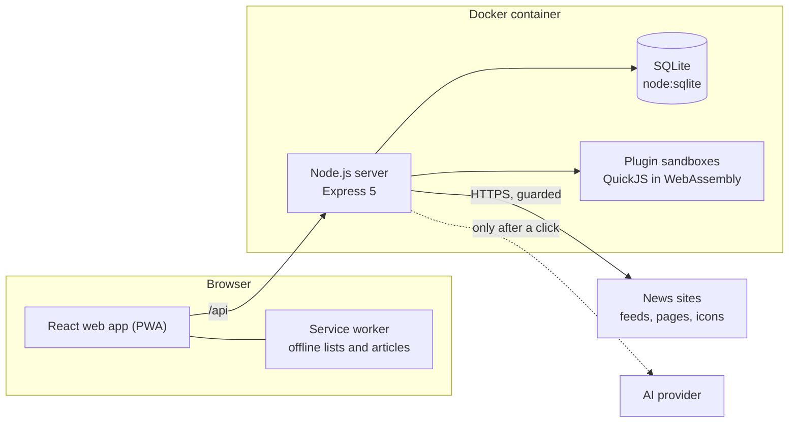

# Architecture

Hodi is deliberately simple: **one Node.js server, one SQLite file, one Docker container**. The server answers a
JSON API and serves the React web app, which keeps working offline. Plugins run beside it, each in a sandbox of its
own.

This page is a map for anyone about to change the code. It says where each part lives and the few rules that hold
everywhere, so that you know which file to open first.

## Stack

- **Server**: Node.js 24, Express 5, TypeScript and the built-in `node:sqlite`
- **Web**: React 19, Vite, CSS Modules and [lucide-react](https://lucide.dev) icons
- **Languages**: [i18next](https://www.i18next.com), with every text in `shared/locales/`
- **Tests**: `node:test` for the server, Vitest for web utilities, Playwright end to end
- **Tooling**: ESLint, Prettier and strict TypeScript, all run by CI on every pull request

The web app has no router and no state library. The hash route lives in `lib/use-hash-route.ts`, and shared state in
small hooks under `lib/`.

## Server

- **`index.ts`** and **`start.ts`**: start-up, background jobs and the setup code
- **`app.ts`** and **`app/`**: the Express app, its headers and its route groups in order
- **`auth/`**: password hashing, session cookies and the login throttle
- **`db/`**: the database, its migrations, and one `*-store.ts` per kind of data
- **`http/`**: the API, one `*-routes.ts` per area, with the session guards
- **`news/`**: feeds, article extraction (on a worker thread of its own, `news/extract-pool.ts`), stories, videos,
  alerts and the AI
- **`mail/`**: e-mails, through the settings of _Server › E-mail_
- **`game/`**: the household game, read from `gamification.yml`
- **`plugins/`**: installed plugins, and the sandbox their server part runs in
- **`test/`**: one `*.test.ts` per module

### Rules across the server

- **Migrations**: a schema change is a new entry at the end of `db/migrations.ts`
- **Outgoing requests**: through `news/fetch-text.ts`, and the SSRF guard for any URL a user gives
- **AI**: through `news/ai-providers.ts`, only from a click, counted against the daily caps
- **Households**: `db/household-scope.ts` keeps the request's household, so a route never sees another's

A feed is one row of `sources` for the whole server, fetched once whoever follows it. Which household follows it, and
in which topics, is that household's row of `household_sources`. `server/test/household-isolation.test.ts` writes a second household in by hand, and checks that neither household ever sees what the other holds.

### Accounts and sign-in

Personal accounts live in `users`, and `profiles.user_id` says whose profile is whose. The codes of **I have a code**
are `sign_in_codes`, and a young profile's own device is a row of `profile_devices` with a cookie of its own.

Every sign-in of an existing account first asks `http/sign-in-check.ts`, which runs each plugin's `checkSignIn` hook.
The server admin's sign-in is never asked, so a broken plugin cannot lock them out.

### The Server space

The routes of `#/server` are in `http/server-routes.ts`, behind `requireServerAdmin`. Its totals come from
`db/server-stats-store.ts`, which keeps each finished day's totals for good in `server_days` and `server_day_reads`
(`db/server-day-counts.ts`). Its durations and backup settings come from `server_settings`, and e-mail from
`server_mail`.

A backup copies the database and the plugins' databases of the same moment. **Restore** sets a copy aside, and the
next start puts it in place, then replays every deletion made since (`db/forget-log.ts`) before anything reads it.

## Web

- **`main.tsx`** and **`App.tsx`**: the entry, then the session's screens in order
- **`api.ts`** and **`api/`**: every call to the server, typed, one module per area
- **`app/`**: the shell, with the sidebar, the bottom bar, the tour and the shortcuts
- **`pages/`** and **`views/`**: the screens and their parts
- **`ui/`**: shared components such as `Button`, `Dialog`, `TextField` and `Toggle`
- **`lib/`**: hooks and helpers for preferences, read state, offline and routes
- **`plugins/`**: loads the active plugins, and `sdk.ts` is what they import
- **`styles/`**: `tokens.css` for colours per theme, `base.css` for fonts and sizes

Colours are CSS variables of `styles/tokens.css`, which change with the theme (Light, Dark, Poudré).\
The layout has three sizes, set in `lib/use-media.ts`:

- **Phone**: up to 600 px, one column and a bottom bar
- **Tablet**: 601 to 1279 px, a single panel
- **Computer**: 1024 px and wider, a sidebar, a list and a reading pane

> [!IMPORTANT]
> Every screen must work at all three. Check one with screenshots at 1440 × 900, 820 × 1180 and 390 × 844.

## Plugins

`plugin-sdk/` builds a plugin folder into a `.hodi-plugin` file, and is also the npm package `@hodi-app/plugin-sdk`.
Its [README](../plugin-sdk/README.md) explains how to write a plugin, and `plugin-sdk/test/hello-world/` is a complete
one that a test builds and runs.

A plugin's server part never runs in Hodi's own engine. `plugins/sandbox/` gives each plugin a worker thread running
QuickJS in WebAssembly, with a memory ceiling, a time limit per call and its own SQLite file.

The main thread answers only what the plugin's `permissions` allow (`plugins/sandbox-requests.ts`), and `http/plugin-routes.ts`
writes its answers itself. Only a signed plugin has its web part served, since that part runs in Hodi's page.

`plugins/catalog.ts` reads the list of [Hodi's plugin registry](https://github.com/leclaudeur/hodi-plugin-registry)
for _Server › Plugins › Available_. A plugin installed from it is downloaded from its GitHub release and checked
against the registry's sha256, then installed like a file.

A plugin that draws the signed-out screens can list public pages in its `plugin.json`. `plugins/public-pages.ts` reads
them without running the plugin's code, and `http/public-pages.ts` serves them before the web app, with their `<head>`,
`robots.txt` and `sitemap.xml`. It does so only once _Server › E-mail_ has Hodi's address.

## Data flow

- **Profiles**: their state lives on the server and is copied in the browser, so the app works offline
- **Sync**: changes go in the background, and the state comes back when the app does, never by polling
- **Offline**: the service worker keeps the last lists and up to 200 opened articles, and drops older versions' files
- **Background**: jobs refresh feeds, shrink pictures, send alerts and make the nightly backup

[← Back to the README](../README.md)
