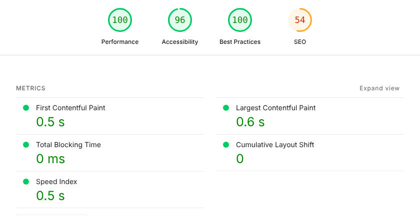
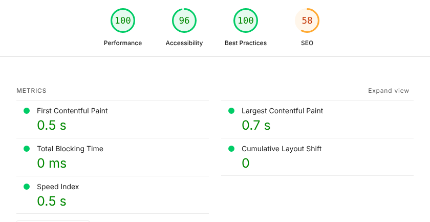
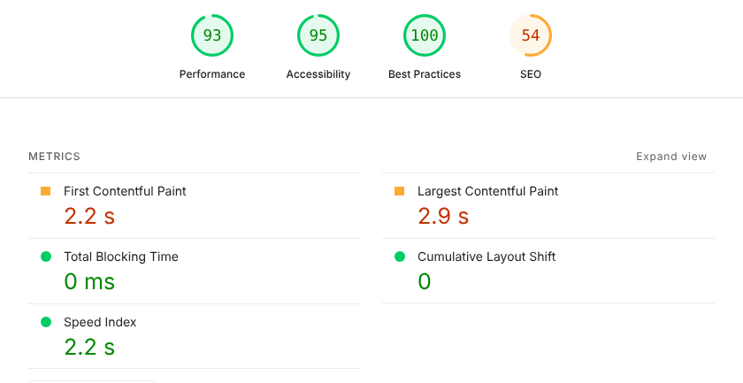
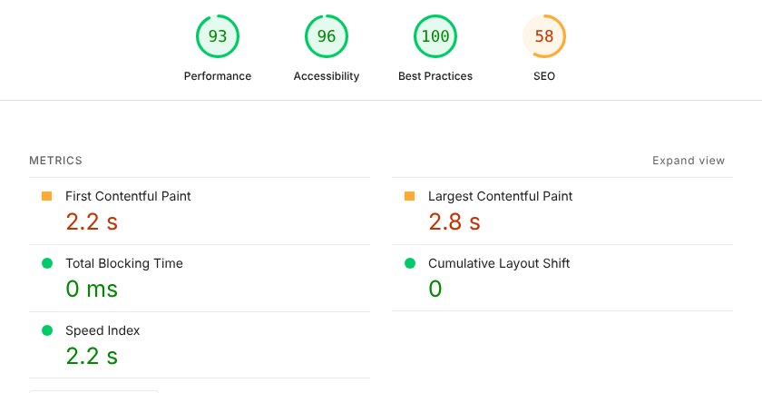
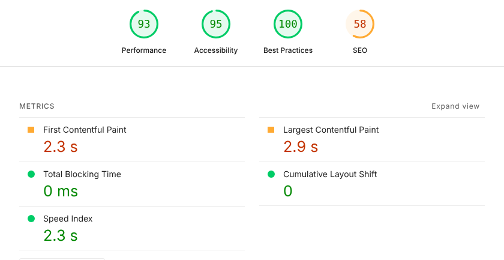
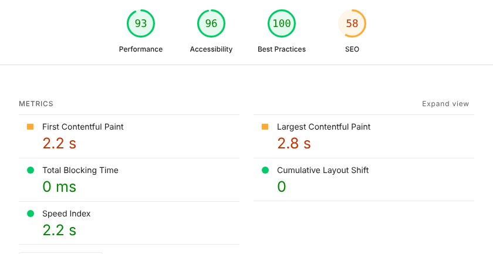

# Performance

Hodi is a news reader you open many times a day, often on a phone with a weak connection, so it should show something fast and cost little battery. This page records how fast it is, how it was measured and what made it fast, so that a change that slows it down is caught before it reaches anyone's phone.

## Results

Lighthouse 12 scored the 21 screens of the app at three sizes. The work ran in two rounds in November 2026: the first took a phone from 59 to 85, and the second, after Hodi gained personal accounts, the server space and plugins, from 85 to 92. The average performance score now:

- **Phone**: **92**, every screen between 87 and 94
- **Tablet**: **92**, every screen between 88 and 94
- **Computer**: **99.8**, twenty screens out of 21 at 100

Accessibility scores 95 to 100 and best practices 96 to 100. SEO stays at 54 to 58 on purpose, since a household's
Hodi is private and asks search engines not to index it.

A plugin's public pages are the exception. Village's welcome page and legal pages score **100** in SEO on a phone and on
a computer, with their title, description, share card and languages. Their performance is 85 to 97 on a computer but
only 53 to 69 on a phone, where the main picture or text (LCP) takes about 7 s: the app's code and the landing's own
script both load before anything is drawn.

_Feed_, the screen opened most often, on a phone, before and after the second round:

- **First text on screen** (FCP): from 2.8 s to **2.2 s**
- **Main picture or text** (LCP): from 3.5 s to **2.9 s**
- **Bytes downloaded**: from 535 KB to **418 KB**

On a computer, its first text shows in 0.55 s and its main picture in 0.66 s.

## The reports

Each picture is the top of the Lighthouse report for one screen, from the last run.

**Computer**: every screen but the server's overview scores 100.

**Phone**: Lighthouse's default mobile profile, a mid-range phone on slow 4G with a CPU four times slower.

**Tablet**: the same network and CPU as the phone, on an 820 × 1180 screen.

## How it was measured

- **The install**: a production build, set up once with the wizard, with no AI key, then copied so that every run starts from the same data
- **The data**: the 4 base sources, 30 articles each, read from real article pages, with JPEG pictures of 1600 × 900
- **The connection**: HTTPS with HTTP/2, as behind a reverse proxy or Tailscale
- **The runs**: Lighthouse 12.8 in headless Chromium, simulated throttling, 63 reports for each version
- **Phone**: Lighthouse's default mobile settings
- **Tablet**: the same settings, on an 820 × 1180 screen at DPR 2
- **Computer**: Lighthouse's desktop settings

> [!TIP]
> Run nothing else on the machine during the reports: another process shows up as blocking time, and one report fell
> from 83 to 34 because of it. Scores also move by 2 or 3 points between runs, so compare averages over several screens.

> [!NOTE]
> Over plain HTTP (`http://<address>:3000` with no proxy), the phone average falls to 86. The browser then opens only
> 6 connections at a time, so the code every start needs comes in one file, but the screens and pictures still wait
> their turn. Put Hodi behind HTTPS: HTTP/2 sends all the files at once.

## What made it fast

- **Compression**: every answer is compressed, and JS and CSS are precompressed with brotli
- **Smaller pictures**: the server makes three WebP widths and a blurred preview with `sharp`
- **No blur on touch screens**: a solid background instead, so scrolling costs the GPU less
- **Early requests**: `web/public/preload.js` asks for the session and the feed while the code downloads
- **Nothing moves**: skeletons hold the exact place of what the home page loads
- **Less background work**: offline downloads wait until the app has shown
- **One language**: English is downloaded only by a household that reads in English
- **Code on demand**: the server space and its charts, the setup wizard, Réglages and the QR code maker download only
  when they open; Réglages is fetched in the background once the app has shown
- **A tidy offline copy**: the service worker removes the files of older versions after an update

Cards, stories and the pictures inside an article each ask for the width they need, from 240 to 960 pixels. An
article's pictures keep their place before they load, so the text never jumps.

## The server

Most answers take 2 to 10 ms, and no SQLite query takes more than 2 ms. Two things cost more, and are kept out of the
requests' way:

- **Reading an article page** (Readability) takes 49 ms at the median and up to a second for a heavy page. It runs on
  a worker thread of its own, started on demand and stopped after a minute without work, so the server keeps
  answering meanwhile.
- **Grouping articles into stories** compares every pair of titles. Each title is analysed once and each date read once,
  so 400 titles take about 18 ms.

These numbers come from a bench with 111 sources and 959 real article pages, on a 2.1 GHz Xeon.

## Battery

At rest, Hodi does almost nothing: 1 to 2 ms of CPU in 20 s, with no layout, no request and no animation frame. Battery
goes to loading, for the radio and the CPU, and to scrolling, for the GPU.

The changes above cut both: the first load of _Feed_ downloads about 80 % fewer bytes, and a phone no longer redraws a blur on every frame while it scrolls.

## What is left

On a phone, every screen waits about 2.2 s before its first text. The browser first downloads and runs about 240 KB of
compressed JavaScript (React, the app and the shared components), and only then can it draw anything. Going further would need the server to send the first screen as HTML, through an app shell or server rendering. That
is a larger change than this work.

[← Back to the README](../README.md)
