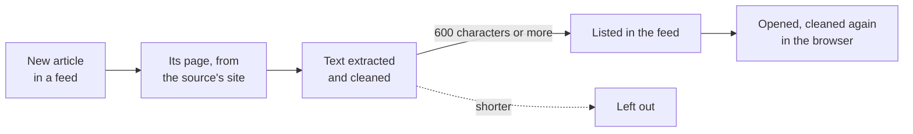

# The reader

Articles open inside Hodi, on a clean page with no ads, menus or pop-ups. This page explains how an article gets there
and the rules the reader follows, then how to help when a page comes out wrong.

## From a feed to the reader



When a feed lists a new article, the server fetches its page in the background and extracts the text. The article is
listed only once that works, so every card of the feed opens in the reader. A source marked `reader: false` is never
extracted: its cards show their summary, with a link to read the article on the source's own site.

Extraction runs in three passes. Hodi first takes the ads out of the page, then
[Readability](https://github.com/mozilla/readability) finds the text, the same library as Firefox's reader view.
Last, Hodi's own cleanup removes everything the site left around the text, from bylines to share buttons.

## The rules

- **No paywall bypass**: under 600 characters, the page is a teaser, a video or a cookie wall, so it is left out
- **Subscribers' articles stay out**: a page kept for subscribers is left out, even when it shows its first lines
- **Only what a feed listed**: the reader opens an article by its id, never by an address
- **The source's own site**: the page and every redirect stay inside the source's domains
- **The feed's text as a fallback**: some sites block their pages but publish the whole text in their feed
- **The whole free story**: when a site sends the end of a free article as data, the reader reads it from there
- **One look for every site**: paragraphs, headings, lists, quotes, pictures, code and tables, nothing else
- **Nothing runs**: players and frames go, a YouTube video becomes a card, and an embedded post stays as text
- **No site furniture**: bylines, dates, share buttons, newsletters, related links and tables of contents go
- **The site's template**: a block found word for word in the source's other articles goes, if it speaks of the site
- **Pictures through the server**: the reader asks for a smaller copy of the article's picture, never by its address
- **Cleaned twice**: the browser sanitizes the text again before it shows it

## Improving the reader

A page that comes out wrong, with a missing paragraph or a leftover "Follow us", is worth a report. Open an issue with
the **Reader problem** template and give the article's address, which is enough to see what went wrong.

To fix it yourself, start from the pass that should have caught it. Each one is a file of `server/news/extract/`:

- **`before-readability.ts`**: ads and layout blocks, taken out before Readability reads the page
- **`bylines.ts`**: bylines, date lines and author bios
- **`media.ts`**: pictures, captions, embedded posts and players
- **`page-cleanup.ts`**: menus, related links, tables of contents and the page's own controls
- **`paywall.ts`**: the signs that an article is kept for subscribers
- **`arc-story.ts`**: free articles whose text comes as data, on Arc XP sites
- **`patterns.ts`**: the words that give furniture away, in French and English
- **`simplify.ts`**: the tags the reader keeps

Every fix comes with a test, made from the real page cut down to the part that goes wrong. The tests also run every
earlier case, from every site already fixed, so that a fix for one site can never break another one:

```bash
npm run test:server    # the reader's tests are server/test/extract*.test.ts
```

> [!IMPORTANT]
> A rule recognises a pattern that any site may use, never one site's address. Name the site in the comment above it,
> as the example that showed the problem.
